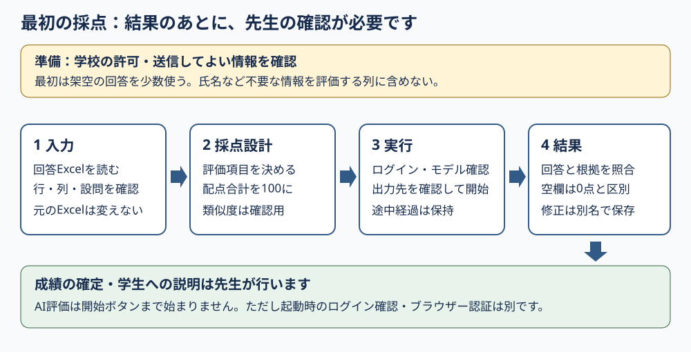

# 先生のための利用ガイド

StudyReport Evaluatorは、Excelにまとめた学生の回答をAIで評価し、**元のExcelを変えずに、結果を別のExcelに保存する**Windowsアプリです。AIの点数・理由を先生が確認するための補助ツールであり、成績や不正行為を自動で確定するものではありません。

> [!WARNING]
> 生成AIが行う評価には正確性が欠ける可能性があるため、必ず自分で責任をもって評点を行ってください。このツールや生成AIは評価結果に対しては一切の責任を負えません

## 最初に読む順番

1. [はじめに](getting-started.md)で、必要なもの、入手方法、最初の採点の流れを確認します。
2. [データと個人情報の扱い](privacy-and-data-handling.md)で、学校の許可と回答を送ってよい範囲を確認します。最初は架空の回答を少数使って試してください。
3. [機能と点数](features.md)で、授業に合う配点・評価項目を決めます。
4. [実行結果Excelの見方](result-excel-description.md)で、点数だけでなく回答・理由・根拠を確認します。

図の読み方：学校の利用許可を確認してから、**1 入力 → 2 採点設計 → 3 実行 → 4 結果**へ進みます。最後は先生が確認・必要な修正を行います。「結果が出た」は「成績を確定してよい」と同じではありません。

## 使っている版を確認してください

**確認日：2026-11-07。現在の公開版は`0.8.6`です。** [GitHub Releases](https://github.com/dahatake/StudyReport-Evaluator/releases/tag/v0.8.6)には、`v0.8.6`の`StudyReportEvaluator-win-x64.exe`、`StudyReportEvaluator-win-x64.exe.sha256`、`StudyReportEvaluator-win-x64.zip`、`StudyReportEvaluator-win-x64.zip.sha256`があります。

| 対象 | このガイドでの扱い |
|---|---|
| 公開`v0.8.6` | 通常の入手先。EXEを優先し、ZIPは代替。通常評価の詳細は**設定 → 通常評価**で編集します |
| 現行ソース`0.8.8` | 未公開のローカル候補。通常評価を**2 採点設計**内で編集するなど、公開版とは異なります。文書では変更点に版を付けます |
| 旧`v0.8.1` | 過去のZIP版。ログインボタンや本頁の設定保存・適用を前提にしないでください |

公開済みであることと動作確認が完了していることは別です。`v0.8.6`の公開前のCH-01〜06 `NOT_RUN`は維持します（追加ソフトのない新しいWindows環境での確認・本人ログインは未実施）。その後の候補版の確認結果を公開版に流用しません。[検証範囲](getting-started.md#v086の検証範囲)を参照してください。

画面画像8枚は合成データ・仮のAI応答による説明用です。2026-09-27の生成時点の画面であり、現行ソースの画面と一致する保証はありません。[画像一覧](../images/README.md)で対象と限界を確認できます。

## やりたいことから探す

| やりたいこと | 読む文書 |
|---|---|
| 入手して、最初の結果を作りたい | [はじめに](getting-started.md) |
| モデル・出力先を変えたい／採点条件を次回も使いたい | [設定ガイド](settings.md) |
| 基礎点・設問配点・類似度の意味を知りたい | [機能と点数](features.md) |
| 点数・根拠を確認して、先生の点に修正したい | [実行結果Excelの見方](result-excel-description.md) |
| 自分の採点基準をAIへの指示文にしたい | [独自の評価指示を書く](custom-evaluator-guide.md) |
| 止まった／空欄がある／保存できない | [トラブルシューティング](troubleshooting.md) |
| どこに何が保存され、何が外部へ送られるか知りたい | [データと個人情報の扱い](privacy-and-data-handling.md) |

## 学校の管理者・開発者向け

先生が最初の採点を行うために、ソースコードのビルドやコマンド入力は必要ありません。

- [製品README](../README.md)：配布形式、動作環境、任意のSHA-256確認、Windowsの警告
- [技術ガイド](technical-guid.md)：内部構成、変更・拡張時の注意
- [起動引数のガイド](prompt-launch.md)：任意のコマンド起動。現行ソースでは`--prompt`を採点に使いません
- [Release自動化](release-automation.md)：配布物の作成・公開前の検証

対応は**Windows 11 x64、標準`.xlsx`**です。公開EXE／ZIPともunsigned（電子署名なし）で、Windowsや学校の端末管理により起動を拒否される場合があります。保護機能を無効にせず、管理者へ相談してください。macOS、Linux、Windows Arm64、暗号化Excel、マクロ付きExcelは対象外です。development MSIXは検証専用で、一般配布しません。

アプリの起動にはExcel／Officeや追加の.NETを要求しない設計（.NET 10 self-contained）です。AIには本人のGitHub Copilot利用権限、インターネット接続、利用可能なモデル、学校の許可が必要です。結果Excelを表計算ソフトで開く場合は、そのソフトが別途必要です。

設定は利用者別の`setting.txt`に平文で保存します。回答Excel、結果Excel、途中経過、設定、画面の共有は学校のルールに従ってください。

本ソフトウェアは[MIT License](../LICENSE)で提供されます。
